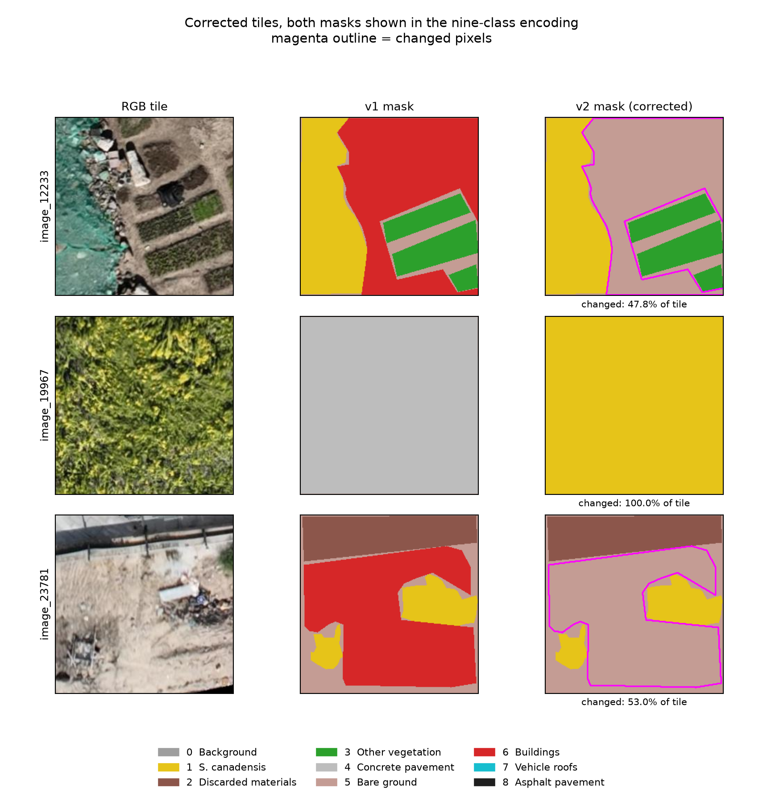

# Nine-class UAV dataset of *Solidago canadensis* — Daishan Island, Zhoushan, China

A manually annotated, multi-class semantic-segmentation dataset of the invasive
perennial *Solidago canadensis* (Canada goldenrod) in a rural–urban fringe, acquired
with a visible-light UAV on 25 October 2025 during the late flowering stage.

This repository holds **the complete dataset** — 7,209 RGB tiles and their 7,209 PNG
masks, ~97 MB — together with the official tile-level split, the machine-readable
label metadata, the label converter and the quality-control material:

```text
data/images/   7,209 × image_<id>.jpg
data/masks/    7,209 × image_<id>_lab.png     (ten-value encoding, v2-corrected)
```

The same data is archived with a DOI on Mendeley Data, which is the citable version:

> **DOI: [10.17632/5pxk3ym2yv](https://doi.org/10.17632/5pxk3ym2yv)** — version 1
> for the original release, version 2 for the corrected release described in
> [`ERRATUM.md`](ERRATUM.md).
> Direct link to v2: <https://data.mendeley.com/datasets/5pxk3ym2yv/2>

The training pipeline and the benchmark numbers of the accompanying article
are in [`solidago-canadensis-segmentation`](https://github.com/CCelliniaTTexas/solidago-canadensis-segmentation).

---

## ⚠️ Read this first: the masks are **not** in 0–8 order

The PNG masks store the annotation campaign's own ten source values (`0`–`9`).
They do **not** equal the nine paper class ids. Two source values (`1` and `4`) are
both concrete pavement and are merged, and source value `6` is the rotation/crop
padding that becomes the background class `0`.

```text
source value in PNG : 0  1  2  3  4  5  6  7  8  9
paper class id      : 5  4  1  3  4  6  0  2  7  8
```

So a mask file whose pixels are mostly `6` is **background**, not buildings; a file
whose pixels are mostly `0` is **bare ground**. Confusing the two is the single most
common error with this dataset — and Table 1 of the paper, whose "Pixel value"
column lists `0–8`, will mislead you if you read it as the stored values.

Run everything through [`tools/convert_masks_10to9.py`](tools/convert_masks_10to9.py),
or verify what you have with [`tools/verify_encoding.py`](tools/verify_encoding.py)
before training. Details and worked examples: [`metadata/encoding.md`](metadata/encoding.md).

---

## Overview

| Item | Value |
|---|---|
| Tiles | 7,209 |
| Tile size | 256 × 256 px |
| Ground footprint per tile | ≈ 8.7 m × 8.7 m |
| Ground sampling distance | 3.4 cm |
| Flight altitude | 120 m |
| Acquisition date | 25 October 2025 |
| Season / phenology | Late flowering–fruiting |
| Location | Daishan Island, Zhoushan, Zhejiang, China |
| Classes | 9 (background + 8 land-cover classes) |
| Annotation | Manual, Labelme, single rule set, no pre-labelling |
| RGB tiles | 7,209 JPEG |
| Masks | 7,209 PNG, 8-bit single channel |
| Total annotated pixels | 472,449,024 |
| Train / validation / test | 5,046 / 1,442 / 721 tiles (7 : 2 : 1) |
| Split protocol | Spatially contiguous blocks (70 / 20 / 10 of a 10 × 10 partition), not random tiles |
| Licensing | CC BY 4.0 — see [`LICENSE`](LICENSE) |

Tiles are **not** split at random. Overlapping sliding-window neighbours would put
near-duplicate views of the same ground into training and test simultaneously and
inflate accuracy. The orthomosaic was divided into 10 × 10 spatial blocks, with
boundaries shifted where a strict grid left a block dominated by rotation and
cropping padding; whole blocks were assigned to the three subsets, so no validation
or test tile touches a training tile. Because the subsets are spatially distinct
blocks, their class composition differs slightly from the global one, and accuracies
are lower than a random split would give.

---

## Classes

`class_id` is what models predict; `png_source_values` are the byte values you will
find in the released PNGs.

| class_id | Class | PNG source values | Proportion of pixels |
|---:|---|---|---:|
| 0 | Background | `6` | 0.19 % |
| 1 | *Solidago canadensis* | `2` | 11.09 % |
| 2 | Discarded construction materials | `7` | 10.02 % |
| 3 | Other vegetation | `3` | 29.15 % |
| 4 | Concrete pavement | `1`, `4` | 14.50 % |
| 5 | Bare ground | `0` | 8.07 % |
| 6 | Buildings | `5` | 19.54 % |
| 7 | Vehicle roofs | `8` | 0.91 % |
| 8 | Asphalt pavement | `9` | 6.52 % |

Class definitions in full: [`metadata/class_definitions.csv`](metadata/class_definitions.csv).
Per-split pixel counts: [`metadata/dataset_statistics.csv`](metadata/dataset_statistics.csv).

Notes on the definitions:

- **Class 0 (Background)** is not a land-cover class. It is the padding left by
  image rotation and rectangular cropping; 99.9 % of it sits on the outer border of
  a tile. Exclude it when you report land-cover accuracy, and state whether you do.
- **Class 4 (Concrete pavement)** aggregates two annotation labels that the campaign
  used interchangeably for grey-white concrete roads; that is why two source values
  map to it.
- **Class 5 (Bare ground)** is exposed soil. It is *not* the same thing as the
  background padding and it is *not* source value `6`.
- **Vehicle roofs (0.91 %)** and **background (0.19 %)** are rare; per-class IoU for
  them is noisy and should not be quoted with two decimals.

---

## Repository layout

```text
.
├── README.md                     this file
├── README.zh-CN.md               condensed Chinese version
├── ERRATUM.md                    what v2 changed, and why
├── CITATION.cff                  citation metadata
├── LICENSE                       CC BY 4.0
├── metadata/
│   ├── class_definitions.csv     class ids, names, PNG source values, proportions
│   ├── dataset_statistics.csv    pixel counts per class per split
│   ├── splits_summary.csv        tile counts and pixel shares per split
│   ├── encoding.md               the 10 → 9 encoding, worked examples, pitfalls
│   ├── data_dictionary.md        every column of every CSV here
│   └── splits/
│       ├── train.txt             5,046 tile stems, one per line
│       ├── valid.txt             1,442 tile stems
│       └── test.txt                721 tile stems
├── corrections/
│   ├── README.md                 what was corrected, tile by tile
│   ├── corrections_report.csv    pixel-level class transitions
│   ├── masks_v1/                 the 3 original (wrong) masks
│   ├── masks_v2/                 the 3 corrected masks, released encoding
│   ├── masks_9class/             the same 3 masks, already converted (convenience)
│   └── figures/corrections.png   RGB / v1 / v2 side by side
├── qc/
│   ├── README.md                 how to use the screening list
│   └── suspicious.csv            509 tiles whose mask and image disagree
├── tools/
│   ├── convert_masks_10to9.py    the converter
│   ├── verify_encoding.py        detect the encoding of a mask folder
│   ├── check_dataset.py          check the data against the metadata
│   └── materialize_splits.py     build train/valid/test folders if you want them
├── docs/
│   └── mendeley_upload_form_original.txt  original upload notes, for provenance
└── data/
    ├── README.md                 the data, the split, and the split caveat
    ├── images/                   7,209 × image_<id>.jpg
    └── masks/                    7,209 × image_<id>_lab.png
```

---

## Getting the data

It is already here. Clone and you have all 7,209 tiles:

```bash
git clone https://github.com/CCelliniaTTexas/solidago-canadensis-uav-dataset.git
cd solidago-canadensis-uav-dataset
ls data/images | head
```

The same data is DOI-archived on Mendeley Data
([10.17632/5pxk3ym2yv](https://doi.org/10.17632/5pxk3ym2yv)). Cite that DOI; treat the
repository as the working copy. If they ever disagree, the DOI is authoritative.

The tile stems in `metadata/splits/*.txt` are the join key:

```text
image_10324  ->  data/images/image_10324.jpg
             ->  data/masks/image_10324_lab.png
```

Note that the web uploader cannot handle a 14k-file repository — clone, commit and push
with the Git CLI. No Git LFS is needed: no file exceeds 20 kB.

---

## Quick start

```bash
git clone https://github.com/CCelliniaTTexas/solidago-canadensis-uav-dataset.git
cd solidago-canadensis-uav-dataset

python -m pip install numpy pillow

# 1. check the encoding of the shipped masks (should say "source")
python tools/verify_encoding.py --masks data/masks --expect source

# 2. convert to the nine paper classes
python tools/convert_masks_10to9.py --src data/masks --dst masks_9class/

# 3. confirm the result matches the published class proportions
python tools/verify_encoding.py --masks masks_9class --expect 9class

# 4. confirm every tile of the published split is present and consistent
python tools/check_dataset.py --images data/images --masks data/masks --expect source

# 5. optional: materialise train/valid/test folders
python tools/materialize_splits.py --data data --out splits
```

A correct conversion reproduces [`metadata/dataset_statistics.csv`](metadata/dataset_statistics.csv)
to within 0.01 percentage points per class. That is the cheapest end-to-end check of
your pipeline; if it fails, the encoding step is wrong and nothing downstream means
anything.

Loading a pair:

```python
import numpy as np
from PIL import Image

stem = "image_10324"
image = np.asarray(Image.open(f"data/images/{stem}.jpg").convert("RGB"))
mask10 = np.asarray(Image.open(f"data/masks/{stem}_lab.png"))  # source values 0..9

LUT = np.array([5, 4, 1, 3, 4, 6, 0, 2, 7, 8], dtype=np.uint8)
mask9 = LUT[mask10]                                          # paper classes 0..8

# if you predict only land cover, drop background (class 0)
ignore_index = 0
```

---

## Version 2 corrections

Three tiles were reported by a user of the dataset and re-checked against the source
imagery. Only the class of the affected regions changed; the geometry is untouched.

| Tile | v1 had | Corrected to | Share of tile |
|---|---|---|---:|
| `image_19967` | 99.1 % concrete pavement, 0.9 % bare ground | *S. canadensis* (the tile is a pure stand) | 100.0 % |
| `image_12233` | 47.9 % buildings | bare ground (open ground mislabelled as buildings) | 47.9 % |
| `image_23781` | 53.0 % buildings | bare ground (open ground mislabelled as buildings) | 53.0 % |



**`data/masks/` already carries these corrections** — there is nothing to patch if you
start from this repository. Exact pixel-level transitions:
[`corrections/corrections_report.csv`](corrections/corrections_report.csv). The
before/after files are in `corrections/masks_v1/` and `corrections/masks_v2/`, both in
the released ten-value encoding, for anyone patching a Mendeley v1 download;
`corrections/masks_9class/` holds the corrected three already converted.

Nothing else changed in v2: the tile count, the splits and the file names are
identical to v1.

---

## Quality control

`qc/suspicious.csv` lists 509 of the 7,209 tiles (7.1 %) whose mask composition and
image statistics are mutually inconsistent — for instance a tile whose mask is
dominated by concrete or asphalt while the image shows a closed vegetation canopy.
Each row carries the mask fractions and the excess-green index used to flag it.

**This is a review list, not a list of errors.** Every tile on it has to be
inspected before being excluded. If you need a conservative training set, hold these
tiles out and say so in your protocol, because metrics computed with and without
them are not comparable. `image_19967` — one of the three tiles corrected in v2 —
appears on this list, which is how the error was caught. See [`qc/README.md`](qc/README.md).

---

## Reference results

Numbers from the accompanying paper on the official test split, nine classes:
70.65 % IoU with 82.0 % precision and 83.6 % recall for *S. canadensis*, and about
75 % mIoU at roughly 20 GFLOPs for the DeepLabV3+ family. They are reported
**including** the background class unless stated otherwise.

They are not a leaderboard; they exist so that you can check a reimplementation end
to end. Two cautions: a random tile split instead of the published blocked split
gives **higher** numbers, because neighbouring tiles are near-duplicates, so do not
mix results obtained under different splits; and per-class IoU for background
(0.19 % of pixels) and vehicle roofs (0.91 %) is noisy and should not be quoted with
two decimals.

---

## Known limitations

- **Single site, single date.** One island, one acquisition on 25 October 2025, late
  flowering. Cross-seasonal and cross-site generalisation is untested.
- **Class imbalance.** Asphalt and vehicle roofs are under 7 % and 1 % of pixels
  respectively; background is 0.19 %. Macro-averaged metrics are dominated by the
  rare classes.
- **Spatially blocked splits.** Deliberate, but it means the subsets are not
  compositionally identical and test accuracy is pessimistic relative to a random
  split.
- **Label noise.** The v2 corrections show that individual tiles can carry wholesale
  class errors; the screening list quantifies how many are worth a second look.
- **Two split layouts exist in the wild.** Working copies circulated with the
  manuscript were arranged as `train/ 5,767`, `valid/ 721`, `test/ 721`. That is not the
  split of the paper, which is `5,046 / 1,442 / 721`; 1,225 tiles differ. The lists in
  `metadata/splits/` are the ones that reproduce Table 2 pixel for pixel. Check any copy
  you inherit against them before comparing results.
- **No Labelme JSON.** The published masks were exported from a later, filtered
  version of the annotations and do not correspond one to one to the raw JSON
  geometry, so the JSON files are not part of the release.

---

## Citation

If you use this dataset, cite the paper and the dataset DOI. Machine-readable
metadata is in [`CITATION.cff`](CITATION.cff):

```bibtex
@dataset{wang_solidago_uav_2026,
  author    = {Wang, Jiajie and Gao, Xu and Qiu, Yichun and Liu, Haijian and
               Wang, Ben and Zhou, Bin and Yuan, Xiaohong and Shum, C. K. and
               Yu, Zhifeng},
  title     = {A nine-class UAV dataset of Solidago canadensis, Daishan Island,
               Zhoushan, China},
  year      = {2026},
  publisher = {Mendeley Data},
  version   = {2},
  doi       = {10.17632/5pxk3ym2yv.2}
}
```

Please also cite the article that describes the annotation protocol and the
baseline experiments:

> Wang, J., Gao, X., Qiu, Y., Liu, H., Wang, B., Zhou, B., Yuan, X., Shum, C. K.,
> & Yu, Z. *A Multi-Class UAV Dataset for Invasive Solidago canadensis Mapping and
> a Controlled Evaluation of When Cross-Attention Helps.* Manuscript.

---

## License

The dataset, the masks and the metadata in this repository are released under the
**Creative Commons Attribution 4.0 International (CC BY 4.0)** licence. You may
share and adapt the material for any purpose, including commercially, provided you
give appropriate credit, link to the licence and indicate whether changes were made.
See [`LICENSE`](LICENSE).

---

## Contact

Zhifeng Yu — yu@hznu.edu.cn
Questions, corrections and additional flagged tiles are welcome as issues or email;
corrections that can be verified against the source imagery will be folded into the
next version rather than into a fork, so that the DOI stays authoritative.

## Versioning

| Version | Date | Change |
|---|---|---|
| v1 | 2025 | Initial release: 7,209 tiles, masks, splits, checkpoints |
| v2 | 2026-10-29 | Three tiles corrected; converter, erratum and screening list added |
