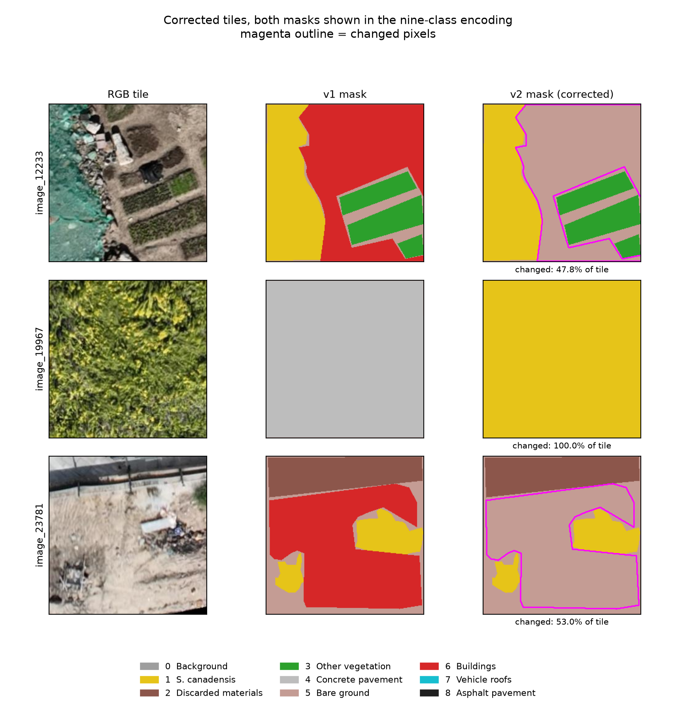

# Corrected tiles (v2)

Three tiles of the v1 release carried wholesale class errors. They were reported by
a user of the dataset, re-checked against the source imagery and relabelled here.



Magenta outlines mark the changed pixels. Both masks are shown in the nine-class
encoding so that v1 and v2 are directly comparable.

---

## What changed

| Tile | v1 | v2 | Area changed |
|---|---|---|---:|
| `image_19967` | 99.1 % concrete pavement, 0.9 % bare ground | 100 % *S. canadensis* | 100.0 % |
| `image_12233` | 47.9 % buildings | buildings → bare ground | 47.9 % |
| `image_23781` | 53.0 % buildings | buildings → bare ground | 53.0 % |

Pixel-exact transitions, including the small remainders, are in
[`corrections_report.csv`](corrections_report.csv):

| tile | from | to | pixels | % of tile |
|---|---|---|---:|---:|
| `image_12233` | Buildings | Bare ground | 31,357 | 47.85 |
| `image_19967` | Concrete pavement | *S. canadensis* | 64,968 | 99.13 |
| `image_19967` | Bare ground | *S. canadensis* | 568 | 0.87 |
| `image_23781` | Buildings | Bare ground | 34,720 | 52.98 |

- `image_19967` is a closed *S. canadensis* stand; the v1 mask called almost the
  whole tile concrete. It had already been flagged by the automated screening list
  (`qc/suspicious.csv`, `built_area_green(exg=69)`) as a green tile annotated as
  built-up, which is how the error surfaced.
- `image_12233` and `image_23781` are open ground — construction sites with exposed
  soil and debris — whose large bare areas were annotated as buildings. Only those
  building regions were relabelled; the vegetation, debris and background regions
  were left untouched, as the identical parts of the two masks show.

Geometry is unchanged in all three tiles. No pixel moved; only the class of the
regions concerned changed.

---

## Which folder to use

Three copies of the same three tiles exist, and the difference matters: picking the
wrong one is silent and ruins the labels.

| Folder | Encoding | Contents | Use when |
|---|---|---|---|
| `../data/masks/` | ten-value source encoding | the **whole** dataset, already corrected | normal use — this is the dataset |
| `masks_v1/` | ten-value source encoding | the three **original, wrong** masks | you want to see what changed, or you are patching an earlier v1 copy |
| `masks_v2/` | ten-value source encoding | the three **corrected** masks | you are patching an earlier v1 copy |
| `masks_9class/` | nine paper class ids `0`–`8` | the three corrected masks, converted | you already work in nine-class ids |

`data/masks/` already contains the v2 labels, so **nothing has to be patched** if you
start from this repository. The patch folders exist for people who downloaded v1 from
before this repository existed, and for auditing the change.

Rule of thumb: keep exactly one encoding per directory and name the directory after
it. If unsure, run

```bash
python tools/verify_encoding.py --masks path/to/your/masks
```

which reports the encoding it detects and how far the class proportions are from the
published ones.

---

## Applying the patch

Only needed for an earlier **v1** copy. From this repository, `data/masks/` is
already corrected — skip this section.

```bash
# source-encoding workflow: overwrite the three files, then convert everything
cp corrections/masks_v2/*_lab.png path/to/v1_masks/
python tools/convert_masks_10to9.py --src path/to/v1_masks/ --dst masks_9class/

# nine-class workflow: overwrite with the converted copies and convert nothing
cp corrections/masks_9class/*_lab.png path/to/masks_9class/
```

Then confirm:

```bash
python tools/verify_encoding.py --masks masks_9class --expect 9class
```

`masks_v2/` and `masks_v1/` hold only three tiles, which is too few for the converter
to recognise the encoding from class proportions; converting either folder on its own
needs `--force`. The normal workflow copies the three files into the full mask folder
first, which is recognised as source encoding without any flag.

The three tiles are all in the **training** split, so the correction changes the
training set, not the evaluation sets. Test metrics reported for v1 remain comparable
with v2 for that reason, but a model retrained on v2 will differ slightly.

---

## Reporting further errors

Send the tile stem, the class you believe is wrong and, if possible, a screenshot of
the source imagery. Corrections that can be verified are folded into the next release
rather than into a fork, so that this repository stays authoritative. Do not open a pull
request that edits masks directly — the released masks are versioned here, and a
fork would silently diverge from it.
